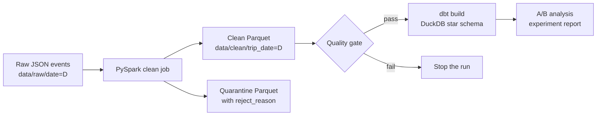

# Ride Trips Data Pipeline

A batch data pipeline for a ride-hailing app, built the way a production pipeline would be: messy raw events go in, and tested, analytics-ready tables come out every day.

- **PySpark** cleans each day of raw trip events: it parses mixed timestamp formats, removes duplicates and quarantines bad rows with a reason.
- A **data-quality gate** stops the run before bad data reaches the warehouse.
- **dbt** models a **star schema** in **DuckDB**, with 24 data tests and a unit test.
- **Airflow** schedules it daily, with retries and safe backfills.
- An **A/B test analysis** (pandas, SciPy) measures a pricing experiment, using the delta method and a sample-ratio check.

The raw data is synthetic, produced by a seeded generator. It is deliberately messy, so the cleaning has real work to do.

## Results (7 days, 2-vCPU machine)

| | |
|---|---:|
| Raw events processed | **1,062,795** |
| Duplicate events removed | 10,670 |
| Rows quarantined, with a reason | 15,460 |
| Clean trips loaded to the warehouse | **1,036,665** |
| End-to-end runtime (generate + Spark + quality gate + dbt) | about 105 s |
| Every input row accounted for | yes (checked by the quality gate each day) |

Re-running or backfilling a day leaves the warehouse unchanged: still 1,036,665 trips and no duplicates.

Rows rejected by reason: negative fare 3,410 · missing zone 4,217 · unknown zone 3,124 · drop-off before pick-up 2,584 · malformed JSON 2,125.

**Experiment result:** upfront pricing raised the ride completion rate from 79.82% to 81.42%, a gain of **+1.60 points** (95% CI +1.44 to +1.75; p < 0.001; the 50/50 split checks out). See [docs/experiment_report.md](docs/experiment_report.md).

## How it works



Airflow runs these steps once a day: `land_raw_trips → clean_with_spark → quality_gate → dbt_build → experiment_report`.

### 1. Cleaning with PySpark (`pipeline/clean_spark.py`)

| Problem in the raw feed | How it is handled |
|---|---|
| The same trip sent twice | Keep the newest version by `updated_at` (window `row_number`) |
| Two timestamp formats (`2027-05-03T08:00:00+00:00` and `2027-05-03 08:00:00`) | Parsed to UTC |
| `COMPLETED`, `Completed`, `completed` | Lower-cased and checked against allowed values |
| Broken JSON lines | Captured with `_corrupt_record` and quarantined |
| Negative fares, missing or unknown zones, drop-off before pick-up, wrong day | Quarantined with a `reject_reason` |

The job also adds `duration_min`, `wait_min`, `fare_per_km` and `is_completed`.

Each run **replaces only its own date partition**. It writes to a temp folder and then swaps it in, so a retry never appends duplicates.

### 2. Quality gate (`pipeline/quality.py`)

The gate checks that every row is accounted for (`rows_in = duplicates + rejected + clean`), and that the Parquet matches the reported counts. It also checks minimum volume, a maximum reject rate, unique `trip_id`, no null keys, and positive fares and durations on completed trips. Any failure exits non-zero, so Airflow stops before the warehouse load.

### 3. Warehouse with dbt + DuckDB (`warehouse/`)

```
stg_trips, stg_experiment_assignments          (views over the lake)
dim_zones, dim_date                            (dimensions)
fact_trips                                     (incremental, one row per trip)
agg_daily_zone_metrics                         (demand, cancel rate, revenue, p90 wait per zone per day)
experiment_rider_metrics                       (one row per rider, for the A/B test)
```

- `fact_trips` is **incremental**, using `delete+insert` on `trip_date`. Loading a day deletes and reloads that whole day, so backfills are idempotent.
- **Tests:** 24 data tests and a dbt **unit test** for the cancel-rate logic. The data tests include:
  - generic tests: unique, not null, accepted values, and relationships from facts to dimensions;
  - singular tests, such as checking that the warehouse row count matches the lake, day by day.

### 4. A/B test analysis (`analysis/ab_test.py`)

Riders, not trips, were randomized, so trips from the same rider are not independent. The analysis therefore:

- treats completion rate as a ratio of per-rider sums;
- uses the **delta method** for its standard error;
- runs a **sample-ratio-mismatch** check before trusting any result.

Tests show it finds a real 1.5-point lift, flags a broken 53/47 split, and keeps false positives near 5% when there is no effect.

## Run it

Needs Python 3.10–3.12 and Java 17+ (for Spark).

```bash
python -m venv .venv && source .venv/bin/activate
make setup
make run            # 7 days x 150,000 trips, then the experiment report
make test           # unit tests, quality-gate tests and a full end-to-end run
```

You can also run one day at a time, the same way Airflow does:

```bash
python -m pipeline.generate    --date 2027-05-03
python -m pipeline.clean_spark --date 2027-05-03
python -m pipeline.quality     --date 2027-05-03
cd warehouse && WAREHOUSE_PATH=$PWD/../data/warehouse.duckdb \
  dbt build --profiles-dir . --vars "{data_dir: '$PWD/../data', run_date: '2027-05-03'}"
```

To run it with Airflow, point `AIRFLOW_HOME`'s `dags_folder` at `dags/` and set `RIDE_TRIPS_HOME` to this folder.

## Tests

`pytest` runs 25 tests:

- the generator's determinism and dirty-data injection;
- every Spark reject rule, deduplication and the timestamp formats;
- row reconciliation and idempotent re-runs;
- quality-gate pass and fail cases;
- the A/B maths (lift detection, false-positive rate, SRM);
- the Airflow DAG structure;
- an end-to-end run that backfills a day and checks nothing doubled.

CI runs everything on every push.

## Project layout

```
pipeline/   generate.py · clean_spark.py · quality.py · run.py
warehouse/  dbt project (models, seeds, tests)
dags/       ride_trips_daily.py (Airflow)
analysis/   ab_test.py
tests/      pytest suite
docs/       experiment_report.md
```

## Future work

- Handle late-arriving events. Today a day's file only holds that day's trips.
- Stream events through Kafka and Spark Structured Streaming for near-real-time metrics.
- Run on a cloud warehouse (BigQuery or Snowflake) by switching the dbt adapter.
